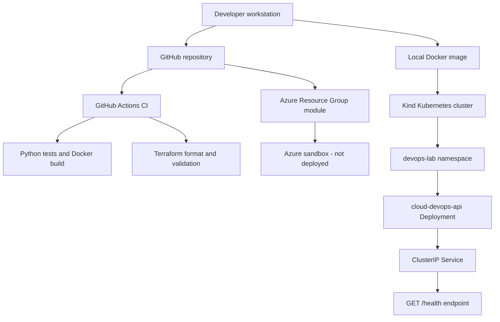

# Cloud DevOps Sprint Architecture

## Current Architecture

## Components

| Component | Responsibility | Current Status |
| --- | --- | --- |
| GitHub | Source control and pull-request workflow | Active |
| GitHub Actions | Tests, Docker build, and Terraform validation | Active |
| Docker | Packages the Python health API | Active |
| Kind | Local Kubernetes learning environment | Active |
| Kubernetes | Runs two API replicas behind a Service | Active |
| Terraform | Defines an Azure Resource Group baseline | Validated only |
| Azure sandbox | Future approved infrastructure deployment | Not deployed |

## Security Boundaries

- No passwords, tokens, API keys, or client data are committed.
- The container runs as a non-root user.
- Kubernetes health probes verify application availability.
- Terraform state and local provider files are excluded from Git.
- Azure infrastructure will not be applied without approved sandbox access.

## Operational Documentation

- `runbooks/deployment-and-rollback.md`
- `runbooks/disaster-recovery.md`

